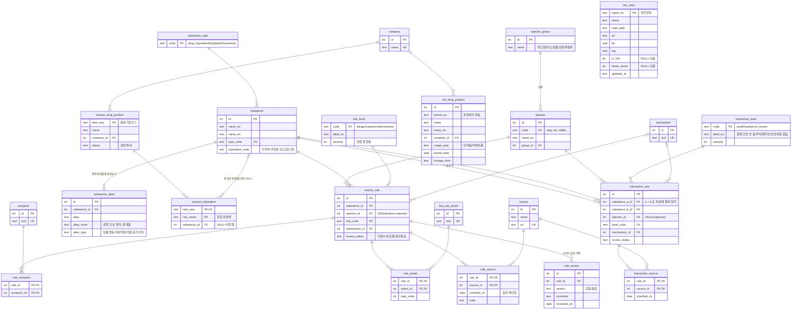

# Phase 1 보고 — 공공데이터 확인 (2026-11-23)

## 1. 받아본 데이터 요약

| 데이터 | 출처 / 받은 방법 | 기준일 | 건수 | 비고 |
|---|---|---|---|---|
| 동물용의약품 품목허가 현황 | 공공데이터포털 파일데이터 15150757 (CSV, UTF-8) | 2025-09-25 | 14,817행 (업체 399곳) | **성분·대상동물 컬럼 없음** |
| 동물_동물병원 인허가 | 공공데이터포털 15045050 → file.localdata.go.kr (CSV, CP949) | 갱신 2026-07 | 10,676행 (영업중 5,502) | 좌표 EPSG:5174, 24시·특수동물 컬럼 없음 |
| 의약품 제품 허가정보 (사람 약) | 식약처 의약품안전나라 공개 검색 화면 (키 없이 소량 조회) | 조회 당일 | 3개 검색어 → 11개 제품 | **서비스용은 OpenAPI 인증키 필요** (아래 4장) |

원본 파일은 `data/raw/`(git 제외), 컬럼 프로파일 전문은 `docs/profile/*.txt`.

### 1-1. 동물용의약품 품목허가 현황 (9개 컬럼)

| 컬럼 | 결측 | 고유값 | 메모 |
|---|---|---|---|
| 허가번호 | 0 | 13,033 | **유일하지 않음**(같은 번호 최대 4행) → 대리키 필요 |
| 업체명 | 0 | 399 | 한국동물약품공업협동조합 930건이 최다 |
| 용도 | 0 | 2 | 동물용의약외품 7,656 / 동물용의약품 7,161 |
| 품목명 | 0 | 14,648 | 한국어 제품명 — 검색 대상 |
| 영문품목명 | 2,065 | 12,598 | 별칭으로 활용 가능 |
| 허가일 | 0 | 4,054 | |
| 업종 | 0 | 3 | 제조 / 수입 / 위탁제조판매 |
| 제형 | 8,793 (59%) | 51 | 산제·액제·주사제 순 |
| 단일복합구분 | 8,967 (61%) | 2 | 단일제 / 복합제 |

→ **주성분과 대상 동물이 없어서 이 파일만으로는 독성 판정에 못 쓴다.** 샴푸·사료첨가제·정액희석제 등 반려동물과 무관한 품목도 섞여 있음.

### 1-2. 동물병원 인허가 (25개 컬럼 중 쓸 것)

| 컬럼 | 결측(전체 10,676) | 메모 |
|---|---|---|
| 관리번호 | 0 | 유일 → PK |
| 사업장명 | 0 | |
| 영업상태명 | 0 | 영업/정상 5,502 · 폐업 5,087 · 취소 등 59 → **영업중만 적재** |
| 도로명주소 / 지번주소 | 1,666 / 193 | 영업중 기준 도로명 결측 21건 |
| 전화번호 | 5,836 | 영업중 기준 2,433건 결측 |
| 좌표정보(X), (Y) | 1,429 | 영업중 기준 234건 결측. **EPSG:5174 → WGS84 변환 확인함** (예: 서울동물영상종양센터 → 37.5659, 127.0033) |
| 휴업시작/종료일자 | 대부분 결측 | 휴업 중 병원 제외에 사용 |

- 24시 여부·특수동물 진료 여부 컬럼은 **없음**. 이름에 "24"가 들어간 영업중 병원 195곳, "특수/이그조틱" 2곳뿐.

## 2. 제품 → 성분 추적 예시 (`scripts/phase1_product_lookup.py`)

| 검색어 | 제품 (품목기준코드) | 주성분 |
|---|---|---|
| 타이레놀 | 타이레놀정500밀리그람 (202106092) | 아세트아미노펜 |
| 타이레놀 | 타이레놀콜드-에스정 (202106954) | 아세트아미노펜 / **슈도에페드린염산염** / 덱스트로메토르판브롬화수소산염 / 클로르페니라민말레산염 |
| 챔프시럽 | 챔프시럽(아세트아미노펜) (201206715, 동아제약) | 아세트아미노펜 |
| 판콜에이 | 판콜에이내복액 (196800036, 동화약품) | 아세트아미노펜 / 구아이페네신 / 펜톡시베린시트르산염 / 페닐레프린염산염 / 클로르페니라민말레산염 / 카페인무수물 |

"타이레놀" 하나로 7개 제품이 나옴 → 검색 결과는 **제품 목록을 먼저 보여주고 고르게** 해야 한다.

**설계에 반영할 발견:** 성분 표기가 제각각이다 — `아세트아미노펜과립`, `아세트아미노펜(미분화)`, `아세트아미노펜 과립`, `슈도에페드린염산염`. 원문 성분명을 그대로 두고, 정규화(제형어·염 접미사 제거) + 별칭 테이블로 표준 물질에 연결해야 한다. 연결 안 된 성분은 "정보 없음"으로 처리 → 종합 등급이 절대 "안전"이 되지 않게.

## 3. ERD 초안

설계 메모
- `risk_level.unknown`은 규칙 테이블에 **저장하지 않는다**. 규칙이 없으면 API가 "정보 없음"을 돌려준다(없는 걸 있다고 만들지 않기).
- 제품 종합 등급 = 연결된 성분들의 `severity` 최댓값. 미연결 성분이 하나라도 있으면 "일부 성분 정보 없음" 표시를 함께 내보냄.
- 기전·증상·대처 문장은 별도 테이블로 빼서 재사용(지시문의 "같은 사유 문장 반복 저장 금지").
- 종 추가는 `species` 행 추가만으로 끝나게 함.
- `rule_review`는 수의사 검토 엑셀을 다시 읽어 들일 때 사용.

### 범위 보완 (2026-11-23, 사용자 요청): 종별 음식 가능/불가 + 성분 병용 가능/불가
> **서비스의 핵심 목적은 병용 점검(`interaction_rule`)이다.** 단일 물질 독성(`toxicity_rule`)은 그 위에 얹는 기능. 근거 자료 목록은 `docs/sources.md`.

- **먹어도 되는 음식 / 안 되는 음식**: 둘 다 `toxicity_rule` 한 테이블에 들어감. 안 되는 음식 = `danger`·`caution`, 먹어도 되는 음식 = `safe`(표시 문구는 "일반적으로 독성 보고가 없습니다", 급여량·주의점은 `first_aid_action` 대신 별도 안내 문장으로). `safe`도 출처가 있어야 넣는다. 출처가 없으면 "정보 없음".
- **병용 가능/불가 성분 조합**: `interaction_rule` 추가 (성분 A × 성분 B × 종 → 함께 쓰면 안 됨 / 주의 / 알려진 상호작용 없음). 약+약뿐 아니라 약+음식도 같은 테이블로 처리 가능.
  - 동작: 사용자가 제품·성분 2개 이상 입력 → 각 제품을 성분으로 풀기 → 모든 성분 쌍을 `interaction_rule`에서 조회 → 규칙 없는 쌍은 "확인된 정보 없음, 수의사 상담 권장".
  - 한계: **사람 DUR 병용금기는 근거로 쓰지 않는다**(지시문 7장). 동물 병용 정보는 공개 자료가 적어서(Merck Vet Manual, 수의학 논문 위주) 시드 수가 독성 규칙보다 훨씬 적을 것이고, 수의사 감수 비중이 가장 큼.

## 4. 결정이 필요한 것

1. **공공데이터포털 인증키**: 식약처 「의약품 제품 허가정보」 OpenAPI 활용신청(무료). 키를 받아 `.env`의 `DATA_GO_KR_KEY`에 넣어주면 API 응답 컬럼을 확인하고 대량 수집 스크립트로 바꾼다. 지금 예시는 공개 검색 화면을 소량 조회한 것.
2. **동물약 데이터 쓰임새**: 성분·대상동물이 없으므로 MVP에서는 "동물용 의약품 제품명 인식 → '동물약입니다. 처방·라벨대로 사용하고, 다른 종에게 쓰지 마세요' 안내" 정도로만 쓰는 안을 제안. (성분까지 필요하면 검역본부 동물약 상세 API가 있는지 따로 찾아봐야 함)
3. **24시·특수동물 표시**: 데이터에 없음. 안 A) 표시 안 함, 안 B) 이름에 "24" 포함 시 "24시(추정)" 표시, 안 C) 지역별 소수 병원만 직접 확인해서 입력.
4. **ERD 승인** → Phase 2(규칙 시드 CSV + 수의사 검토용 xlsx) 시작.
